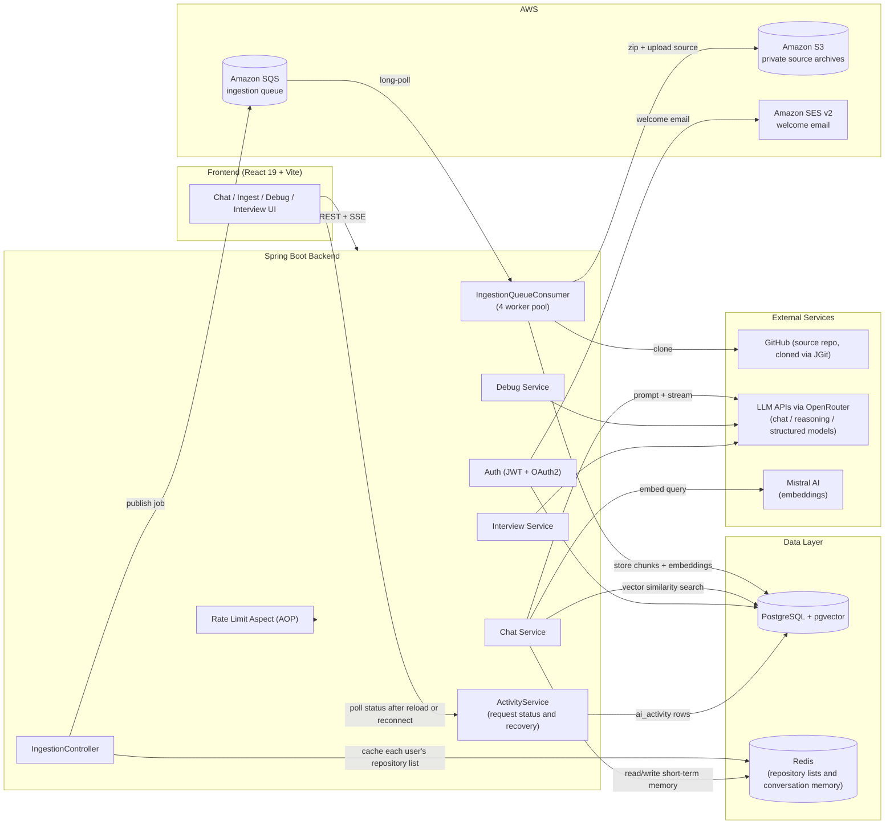
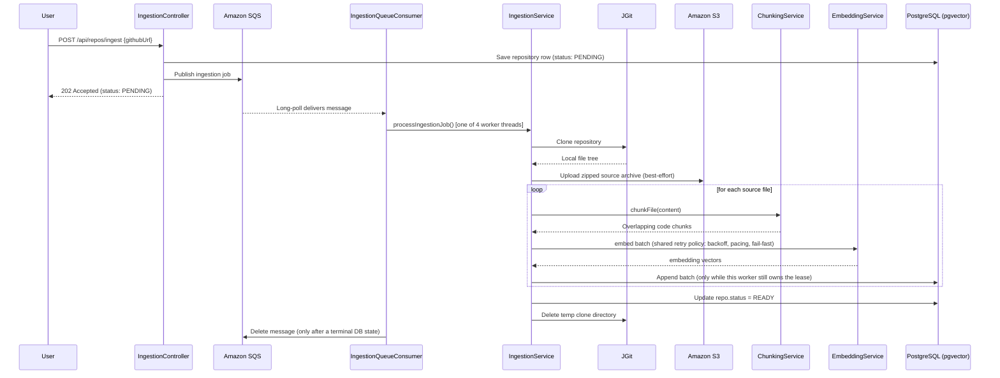
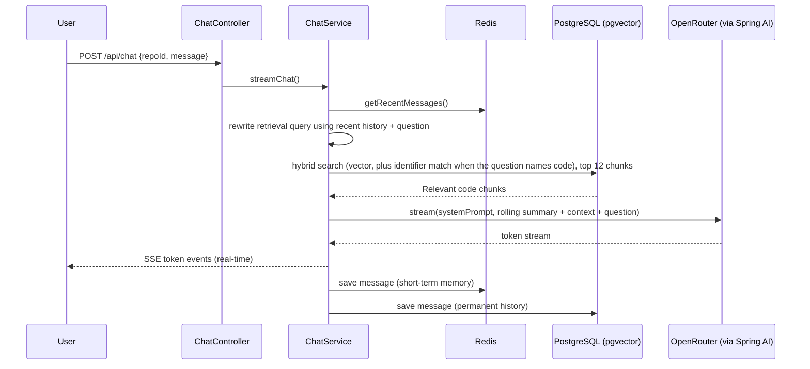
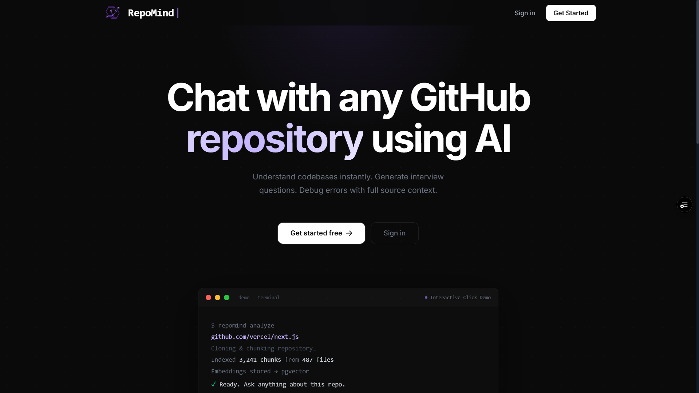
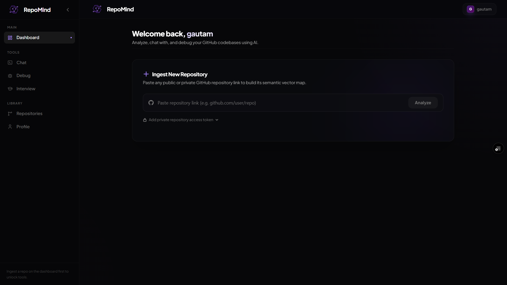
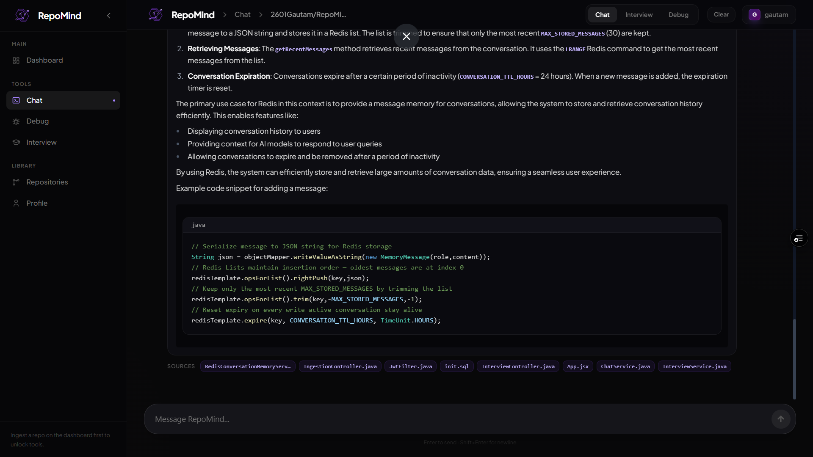
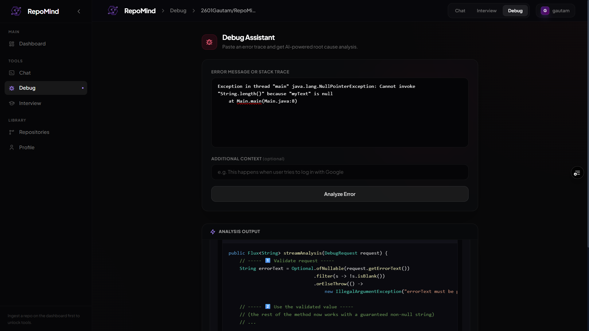
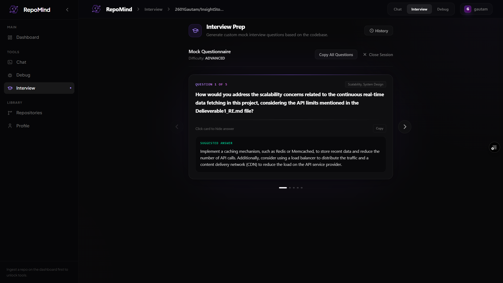

# RepoMind

### Chat with any GitHub repository — powered by Retrieval-Augmented Generation (RAG)

RepoMind ingests a public or private GitHub repository, understands its codebase, and lets you ask it questions in plain English — with answers grounded in the actual source code, not guesswork.

<p align="center">
  <a href="https://github.com/2601Gautam/RepoMind/actions/workflows/quality.yml"></a>
  
  
  
  
  
  
  
  
</p>

---

## Table of Contents

- [Overview](#overview)
- [Problem Statement](#problem-statement)
- [Solution](#solution)
- [Key Features](#key-features)
- [Architecture](#architecture)
- [Technology Stack](#technology-stack)
- [Project Structure](#project-structure)
- [Getting Started](#getting-started)
- [Configuration and Environment Variables](#configuration-and-environment-variables)
- [Running Locally](#running-locally)
- [Docker](#docker)
- [Usage Guide](#usage-guide)
- [API Overview](#api-overview)
- [Testing and Evaluation](#testing-and-evaluation)
- [Quality and Reliability](#quality-and-reliability)
- [Screenshots](#screenshots)
- [Roadmap and Future Improvements](#roadmap-and-future-improvements)
- [Contributing](#contributing)
- [Authors](#authors)
- [Acknowledgements](#acknowledgements)

---

## Overview

**RepoMind** is a full-stack AI application that turns any GitHub repository into an interactive, queryable knowledge base. Point it at a repo URL, and once ingestion completes, you can chat with the codebase — ask where something is implemented, how a module works, or why a piece of logic exists — and get answers grounded in the real code, complete with file names and line numbers.

Beyond chat, RepoMind also includes an AI-assisted error/debug analyzer, an auto-generated interview Q&A feature based on the ingested codebase, and a durable AWS-backed ingestion pipeline.

## Problem Statement

Understanding an unfamiliar codebase — whether it's a new job's repo, an open-source project, or your own project months later — is slow. Traditional code search (grep, IDE search) requires knowing the right keywords, and reading through hundreds of files just to answer a simple architectural question doesn't scale. General-purpose AI chatbots can't help either, since they were never trained on your specific, often-private repository, and cannot fit an entire codebase into a single prompt.

## Solution

RepoMind solves this with **Retrieval-Augmented Generation (RAG)**:

1. The repository is cloned, split into overlapping code chunks, and converted into vector embeddings stored in PostgreSQL (via the `pgvector` extension).
2. When you ask a question, RepoMind embeds your question, retrieves the most semantically relevant chunks of code, and feeds them — along with your question — to an LLM.
3. The LLM is instructed to answer **only from the retrieved code**, and to say so explicitly if the answer isn't present, minimizing hallucination and keeping every answer traceable back to real files.

The result: accurate, source-grounded answers about a codebase the AI model has never seen before, without any fine-tuning.

---

## Key Features

- **Conversational Codebase Chat** — Ask natural-language questions about any ingested repository and get streamed, real-time answers (via Server-Sent Events) with cited source files.
- **Identifier-Aware Retrieval** — Questions that name a function or variable (camelCase or snake_case) fuse pgvector similarity with a text match on stored identifier terms using reciprocal-rank fusion; plain-prose questions keep pure vector search. See [measured results](#quality-and-reliability).
- **Durable, Queue-Backed Ingestion** — Paste a GitHub URL; the API persists the job and publishes it to an Amazon SQS queue before returning `202 Accepted`, so an in-flight ingestion survives an application restart or redeploy. Workers hold a renewable, fenced database lease, so a crashed worker's job is recovered and a stale worker cannot overwrite a new one; failed attempts are retained for retry and end in a dead-letter queue instead of being lost.
- **Rate-Limit-Aware Embedding Retries** — One retry policy for ingestion, sync, chat and debug: HTTP 429 and 5xx are retried with jittered exponential backoff inside a time budget, workers pause together after a 429, and bad credentials or bad requests fail immediately. Exhaustion never fans out into more provider calls.
- **Failure Visibility and Recovery** — Ingestion failures show their reason on every page, queued retries are labelled, and after a reload, network drop or new login the app asks `GET /api/activity` what is still running, finished or interrupted. Interrupted AI streams are reported, never silently resubmitted.
- **Context-Aware Chunking** — Uses a sliding-window chunking strategy with overlap so functions and logical blocks are never split across chunk boundaries.
- **Multi-Turn Conversational Memory** — Redis-backed short-term memory (with TTL expiry) provides recent context for rewriting retrieval queries, while PostgreSQL retains permanent chat history and a rolling conversation summary is included in the answer prompt. A Redis outage degrades to a database read; it does not fail the request.
- **Incremental Repository Sync** — Re-syncing a repo diffs against its last indexed commit SHA instead of re-cloning and re-embedding everything, and publishes the changed paths and the new revision in a single locked transaction so the last complete index survives any failure.
- **Private Source Archival (Amazon S3)** — After ingestion, the extracted source is zipped and uploaded to a private S3 bucket, since the local clone is deleted to avoid filling server disk. Owners can request a short-lived (15-minute) presigned download URL for the archive.
- **Transactional Welcome Email (Amazon SES)** — New email/password registrations trigger an asynchronous welcome email via SES v2; a delivery failure never blocks registration.
- **AI-Powered Debug Analyzer** — A dedicated `/api/debug` flow using a lower-temperature "reasoning" LLM client tuned for careful error analysis.
- **Auto-Generated Interview Questions** — Generates structured interview-style Q&A based on the ingested repository, using a low-temperature, structured-output LLM client; the output is validated before it is stored.
- **Secure Authentication** — Stateless JWT authentication (HttpOnly cookies), BCrypt password hashing, plus Google and GitHub OAuth2 login.
- **API Rate Limiting** — Token-bucket rate limiting (Bucket4j) applied declaratively via a custom `@RateLimit` annotation and an AOP aspect. Buckets are currently stored in a per-instance in-memory map.
- **Real-Time Token Streaming** — Answers stream token-by-token to the frontend using reactive `Flux` + SSE, with exactly one terminal event (`done` or `error`) per stream.
- **Per-User Repository Dashboard** — Every ingested repo, its ingestion status (`PENDING` / `PROCESSING` / `READY` / `FAILED`), and its conversations are scoped to the authenticated user.

---

## Architecture

### High-Level System Diagram



### Ingestion Pipeline



### Chat / Query Pipeline



> **Note on ingestion status:** a repository sits in `PENDING` from the moment its row is created until an `IngestionQueueConsumer` worker claims it, which moves it to `PROCESSING` under a random owner token and a renewable lease. `READY` is written only by the owner. If an attempt fails for a recoverable reason (provider outage, rate limit, database error), the job returns to `PENDING` with its last error shown to the user and the SQS message is kept, so it is retried and, after the queue's redrive limit, moved to the dead-letter queue. `FAILED` is reserved for terminal outcomes such as a repository with no supported source files. The application does not read the dead-letter queue: an operator must monitor and redrive it.

---

## Technology Stack

### Backend
| Category | Technology |
|---|---|
| Language | Java 21 |
| Framework | Spring Boot 4.0.6 |
| AI Orchestration | Spring AI 2.0.0 (`spring-ai-starter-model-openai`, `spring-ai-starter-model-mistral-ai`) |
| LLM Provider | Routed through [OpenRouter](https://openrouter.ai) (OpenAI-compatible endpoint), so the underlying model per role (chat / reasoning / structured / summary) is configurable without a code change |
| Embedding Model | Mistral AI (`mistral-embed`) |
| Database | PostgreSQL with the `pgvector` extension |
| Caching / Memory | Redis (`spring-boot-starter-data-redis`) |
| Background Jobs | Amazon SQS — durable ingestion queue, long-polled by a bounded worker pool |
| Object Storage | Amazon S3 — private, presigned-URL-only archive of each ingested repository's source |
| Transactional Email | Amazon SES v2 — async welcome email on registration |
| Auth | JWT (`jjwt-api`, `jjwt-impl`, `jjwt-jackson`), Spring Security, OAuth2 Client (Google & GitHub) |
| Rate Limiting | Bucket4j (`bucket4j_jdk17-core`, `bucket4j_jdk17-lettuce`) via a custom AOP aspect; buckets are currently stored in an in-memory `ConcurrentHashMap` per backend instance |
| Repository Access | JGit (`org.eclipse.jgit`) |
| Reactive/Streaming | Spring WebFlux (`Flux`), Server-Sent Events |
| Utilities | Lombok, Spring Retry, Spring Dotenv, AWS SDK for Java v2 (S3, SQS, SES) |
| Build Tool | Maven (via `mvnw` wrapper) |
| Testing | JUnit 5, Mockito, Spring Boot Test; disposable PostgreSQL + pgvector, Redis and LocalStack (SQS) via Docker Compose |

### Frontend
| Category | Technology |
|---|---|
| Framework | React 19 |
| Build Tool | Vite |
| Routing | React Router |
| Styling | Tailwind CSS (`@tailwindcss/typography`) |
| HTTP Client | Axios |
| Markdown / Code Rendering | `react-markdown`, `remark-gfm`, `react-syntax-highlighter` |
| Icons | `lucide-react` |
| Tests | Node's built-in test runner (`npm test`) |

### Infrastructure
| Category | Technology |
|---|---|
| Containerization | Docker (multi-stage build: Maven → Eclipse Temurin JRE Alpine) |
| Backend Hosting | Render |
| Frontend Hosting | Vercel |
| Database Hosting | NeonDB (managed PostgreSQL, referenced in `application-prod.yml`) |
| Background Queue / Storage / Email | AWS (SQS, S3, SES) — see [AWS_SERVICES_EXPLAINED.md](AWS_SERVICES_EXPLAINED.md) for the full setup and design rationale |

---

## Project Structure

```
RepoMind/
├── Dockerfile                          # Multi-stage build: Maven build → JRE Alpine runtime
├── init.sql                            # Database schema (new installs)
├── migrations/                         # Dated SQL migrations for existing databases
├── pom.xml                             # Maven dependencies & build config
├── mvnw / mvnw.cmd                     # Maven wrapper scripts
├── AWS_SERVICES_EXPLAINED.md           # Deep dive: why/how SQS, S3, SES, and IAM are used
├── SETUP_AWS.md                        # Step-by-step AWS console setup guide
├── .github/workflows/quality.yml       # CI: backend regression suite, frontend tests and build
│
├── src/main/java/com/repomind/repomind/
│   ├── config/                         # AiConfig (LLM beans), AwsConfig (S3/SQS/SES clients),
│   │                                    # SecurityConfig, JacksonConfig, RepositoryCacheConfig
│   ├── controller/                     # ChatController, IngestionController, DebugController,
│   │                                    # AuthController, InterviewController, ActivityController,
│   │                                    # HealthController
│   ├── service/
│   │   ├── ingestion/                  # FileCloneService, ChunkingService, EmbeddingService,
│   │   │                                # EmbeddingRetryPolicy, GitHubApiService, SyncService,
│   │   │                                # IngestionService, FullIngestionStore (claim/lease/fencing),
│   │   │                                # IngestionHeartbeat, IndexSnapshotWriter
│   │   ├── queue/                      # IngestionQueuePublisher, IngestionQueueConsumer (SQS)
│   │   ├── ChatService.java            # Core RAG chat/streaming logic
│   │   ├── ChatRetrieval.java          # Hybrid (vector + identifier) search
│   │   ├── ActivityService.java        # Request status for reload/reconnect recovery
│   │   ├── StreamJson.java             # Serializes stream events with exactly one terminal event
│   │   ├── S3StorageService.java       # Repo-archive upload/download/delete on S3
│   │   ├── EmailService.java           # SES welcome email
│   │   ├── RedisConversationMemoryService.java
│   │   ├── RateLimitService.java
│   │   └── PromptBuilder.java
│   ├── security/                       # JwtFilter, JwtUtil, OAuth2SuccessHandler
│   ├── aspect/                         # RateLimitAspect (AOP)
│   ├── repository/                     # Spring Data JPA repositories (incl. native pgvector query)
│   ├── model/entity/                   # User, RepoEntity, CodeChunk, Conversation, Message, etc.
│   ├── dto/                            # request/, response/, queue/ (IngestionJobMessage) DTOs
│   └── annotation/                     # Custom @RateLimit annotation
│
├── src/main/resources/
│   ├── application.yml                 # Base configuration (incl. AWS and Spring AI retry settings)
│   └── application-prod.yml            # Production overrides (DB, Redis, OAuth2, model routing, ingestion)
│
├── src/test/                           # Unit and integration tests; evaluation tests under evaluation/
│
├── eval/                               # Benchmarks, frozen question sets, results and the failure log
│   ├── README.md                       # How to re-run everything
│   ├── REPORT.md                       # Measured results, method and limits for every number
│   ├── compose.yml                     # Disposable PostgreSQL, Redis and LocalStack for the tests
│   ├── golden/                         # Reference questions and saved embeddings
│   └── results/                        # Saved raw results
│
└── frontend/
    ├── package.json
    ├── vite.config.js
    ├── test/                           # Node tests (stream reader, recovery state)
    └── src/
        ├── api/                         # client.js (API client), readSseStream.js
        ├── context/                     # AuthContext.jsx, ActivityContext.jsx
        ├── state/recovery.js            # Status polling and request journal
        ├── hooks/useAiOperation.js
        ├── components/
        │   ├── chat/  debug/  repo/  layout/  common/ (incl. ActivityPanel)
        └── pages/
            ├── LandingPage.jsx
            ├── LoginPage.jsx / RegisterPage.jsx / OAuthCallbackPage.jsx
            ├── DashboardPage.jsx / AllReposPage.jsx
            ├── IngestPage.jsx
            ├── ChatPage.jsx
            ├── DebugPage.jsx
            ├── InterviewPage.jsx
            └── ProfilePage.jsx
```

---

## Getting Started

### Prerequisites

- **Java 21** (JDK)
- **Maven** (or use the included `mvnw` wrapper)
- **Node.js** (v18+) and **npm** — for the frontend
- **PostgreSQL** with the `pgvector` extension installed
- **Redis** (local instance or a managed service)
- An **AWS account** with an SQS queue, S3 bucket, and SES-verified sender — see [SETUP_AWS.md](SETUP_AWS.md) (the app requires `AWS_SQS_INGESTION_QUEUE_URL` at startup)
- API keys for:
  - **OpenRouter** (chat/reasoning/structured LLM inference)
  - **Mistral AI** (embeddings)
  - **Google OAuth2** and **GitHub OAuth2** (optional, only if you want social login)

### Clone the repository

```bash
git clone https://github.com/2601Gautam/RepoMind.git
cd RepoMind
```

---

## Configuration and Environment Variables

RepoMind reads secrets and environment-specific values via environment variables (loaded through `spring-dotenv`, i.e. a `.env` file at the project root, or your platform's native environment variables). Based on `application.yml` and `application-prod.yml`, the following variables are used:

| Variable | Required | Description |
|---|---|---|
| `JWT_SECRET` | Yes | Secret key used to sign JWTs. Must be at least 256 bits (32+ characters). |
| `DATABASE_URL` | Yes (prod) | PostgreSQL connection string (e.g. from NeonDB). |
| `DB_USER` | Yes (prod) | Database username. |
| `DB_PASSWORD` | Yes (prod) | Database password. |
| `REDIS_URL` | Yes (prod) | Redis connection URL. |
| `OPENROUTER_API_KEY` | Yes | API key for OpenRouter (routes to the configured chat/reasoning/structured LLMs). |
| `CHAT_MODEL` | No | Overrides the fast chat model used for normal conversation (defaults to `openrouter/free`). |
| `REASONING_MODEL` | No | Overrides the model used by the debug analyzer. |
| `STRUCTURED_MODEL` | No | Overrides the model used for structured/interview output. |
| `SUMMARY_MODEL` | Yes (prod) | Model used to summarize/condense conversation context. |
| `MISTRAL_API_KEY` | Yes | API key for Mistral AI (used for embeddings). |
| `AWS_ACCESS_KEY_ID` / `AWS_SECRET_ACCESS_KEY` | Yes | Static credentials for the dedicated least-privilege IAM user (S3, SQS, SES). |
| `AWS_REGION` | No | Defaults to `ap-south-1`. |
| `AWS_S3_BUCKET` | Yes | Bucket for private per-repository source archives. |
| `AWS_SES_FROM_EMAIL` | Yes | Verified SES sender address for the welcome email. |
| `AWS_SQS_INGESTION_QUEUE_URL` | Yes | No fallback — the app fails at startup without it, since accepting an ingestion request without a durable queue behind it would be misleading. |
| `AWS_SQS_CONSUMER_ENABLED` | No | Defaults to `true`. Set to `false` only in tests, to stop a test context from polling AWS. |
| `GOOGLE_CLIENT_ID` / `GOOGLE_CLIENT_SECRET` | No | Required only if enabling Google OAuth2 login. |
| `GITHUB_CLIENT_ID` / `GITHUB_CLIENT_SECRET` | No | Required only if enabling GitHub OAuth2 login. |
| `CORS_ALLOWED_ORIGIN` | No | Frontend origin allowed by CORS (defaults to `http://localhost:5173`). |
| `WORKER_COUNT` | No | Ingestion worker threads per instance (defaults to `4`). |
| `INGESTION_EMBEDDING_BATCH_SIZE` | No | Chunks per embedding request (defaults to `20`). |
| `INGESTION_MAX_EMBED_RETRIES` | No | Attempts per embedding call before the job is released for retry (defaults to `8`). |
| `INGESTION_EMBED_RETRY_BASE_MS` / `_MAX_MS` / `_BUDGET_MS` | No | Backoff base (`1000`), backoff cap (`30000`) and the total waiting budget per call (`180000`). |

> Spring AI's own retry is bounded in `application.yml` (`spring.ai.retry.max-attempts: 3`, where the value counts retries) so it does not multiply with the embedding policy above.

> **Note:** The repository does not include a `.env.example` file. Create your own `.env` file in the project root based on the table above before running the app. Never commit real secrets to version control.

Example `.env` (for local development):

```env
JWT_SECRET=replace_with_a_long_random_secret_at_least_32_characters
DATABASE_URL=jdbc:postgresql://localhost:5432/repomind
DB_USER=postgres
DB_PASSWORD=postgres
REDIS_URL=redis://localhost:6379
OPENROUTER_API_KEY=your_openrouter_api_key
MISTRAL_API_KEY=your_mistral_api_key
AWS_ACCESS_KEY_ID=your_iam_access_key_id
AWS_SECRET_ACCESS_KEY=your_iam_secret_access_key
AWS_REGION=ap-south-1
AWS_S3_BUCKET=repomind-dev-archives
AWS_SES_FROM_EMAIL=verified-sender@example.com
AWS_SQS_INGESTION_QUEUE_URL=https://sqs.ap-south-1.amazonaws.com/123456789012/repomind-dev-ingestion
CORS_ALLOWED_ORIGIN=http://localhost:5173
```

See [SETUP_AWS.md](SETUP_AWS.md) for how to create the queue, bucket, SES identity, and IAM user referenced above.

### Database Setup

Run the provided `init.sql` against your PostgreSQL instance to create the required extensions (`vector`, `uuid-ossp`) and tables (`users`, `repositories`, `code_chunks`, `ai_activity`, and related tables):

```bash
psql -U postgres -d repomind -f init.sql
```

For an existing deployment, apply the migrations in date order **before** deploying the application update:

```bash
psql -U postgres -d repomind -f migrations/20260902_add_repository_is_private.sql
psql -U postgres -d repomind -f migrations/20260902_enforce_unique_repository_urls.sql
psql -U postgres -d repomind -f migrations/20260905_add_repository_sync_message.sql
psql -U postgres -d repomind -f migrations/20261117_add_conversation_summary_and_sources.sql
psql -U postgres -d repomind -f migrations/20261117_add_identifiers_index.sql
psql -U postgres -d repomind -f migrations/20261117_add_ingestion_owner.sql
psql -U postgres -d repomind -f migrations/20261117_add_ai_activity.sql
```

Two of these need care. `20261117_add_identifiers_index.sql` adds a stored generated column to `code_chunks`, which rewrites that table, so run it in a quiet period. `20261117_add_ingestion_owner.sql` introduces token-based job ownership: stop and drain old ingestion workers before deploying the new version, because older binaries do not take part in ownership or lease renewal. The ingestion consumer's IAM role also needs `sqs:ChangeMessageVisibility` (see [SETUP_AWS.md](SETUP_AWS.md)).

> Note: `application.yml` sets `ddl-auto: validate` — meaning Hibernate will **validate** the schema against your entities but will **not** auto-create tables. Running `init.sql` (or the migrations) first is required.

---

## Running Locally

### 1. Backend (Spring Boot)

```bash
./mvnw clean install
./mvnw spring-boot:run
```

The backend starts on `http://localhost:8080` by default (Spring Boot's default port, unless configured otherwise).

### 2. Frontend (React + Vite)

```bash
cd frontend
npm install
npm run dev
```

The frontend starts on Vite's default dev server (typically `http://localhost:5173`).

> Vite bakes environment variables into the build **at build time**. If you configure a custom API base URL for the frontend, make sure it's set correctly before running `npm run build` for production.

---

## Docker

A `Dockerfile` is provided for the **backend** using a multi-stage build (Maven build stage → lightweight Eclipse Temurin JRE Alpine runtime image):

```bash
# Build the image
docker build -t repomind-backend .

# Run the container
docker run -p 8080:8080 --env-file .env repomind-backend
```

> Note: The repository provides a Dockerfile for the **backend only**. There is no frontend Dockerfile and no Compose file for running the whole application; running PostgreSQL, Redis, and the frontend locally alongside the container is a manual setup step. `eval/compose.yml` starts disposable PostgreSQL, Redis and LocalStack containers for the **tests only** and must never be pointed at a real database.

---

## Usage Guide

1. **Register / Log in** — create an account (email/password) or sign in with Google/GitHub OAuth2. A new email/password registration triggers an async welcome email via SES.
2. **Ingest a Repository** — from the dashboard, submit a public (or token-authenticated private) GitHub repository URL. The API queues the job on SQS and returns `202 Accepted`; a worker clones, archives to S3, chunks, and embeds it in the background, and progress is shown by polling. If an attempt fails you see the reason, and a job that will be retried is labelled "Awaiting retry".
3. **Chat** — once a repo's status is `READY`, open the Chat page and ask questions in natural language. Answers stream in real time and cite the specific files they were drawn from.
4. **Debug** — use the Debug page to paste an error/stack trace and get an AI-assisted analysis grounded in the ingested repository's code.
5. **Interview Prep** — generate structured interview-style questions and answers based on the ingested codebase from the Interview page.
6. **Sync** — re-sync a `READY` repository to pick up new commits without a full re-ingestion.
7. **Download Archive** — request a 15-minute presigned S3 download link for the exact source snapshot that was indexed.
8. **Recover after a disconnect** — after a reload, network drop or new login, the activity panel at the top of the page shows which repositories are still indexing and which chat, debug or interview requests are running, finished or were interrupted. Interrupted requests are not resubmitted for you; check the saved chat or interview history before sending again.
9. **Manage Repositories** — view all your ingested repositories, their status, and delete ones you no longer need from the "All Repos" page.

---

## API Overview

All endpoints are prefixed under `/api`. Authentication uses a JWT stored in an HttpOnly cookie, set after login/registration/OAuth2.

### Auth — `/api/auth`
| Method | Endpoint | Description |
|---|---|---|
| POST | `/api/auth/register` | Register a new user (triggers an async SES welcome email) |
| POST | `/api/auth/login` | Log in and receive a JWT (HttpOnly cookie) |
| GET | `/api/auth/me` | Get the current authenticated user |
| POST | `/api/auth/logout` | Log out (clears the auth cookie) |
| GET | `/api/auth/profile/stats` | Get profile statistics for the current user |

### Repository Ingestion — `/api/repos`
| Method | Endpoint | Description |
|---|---|---|
| POST | `/api/repos/ingest` | Submit a GitHub URL; the job is durably queued on SQS. Returns `202 Accepted`. |
| POST | `/api/repos/{repoId}/sync` | Incrementally re-sync a `READY` repository against its last-indexed commit |
| GET | `/api/repos/{repoId}/status` | Poll ingestion status/progress |
| GET | `/api/repos/{repoId}/archive` | Get a 15-minute presigned S3 download URL for the repo's source archive |
| GET | `/api/repos` | List all repositories for the current user (plain, non-paginated list) |
| DELETE | `/api/repos/{repoId}` | Remove this user's access; if no user has access left, delete the repo, its chunks, and its S3 archive |

### Chat — `/api/chat`
| Method | Endpoint | Description |
|---|---|---|
| POST | `/api/chat` | Ask a question; streams the answer via Server-Sent Events |
| GET | `/api/chat/history/{repoId}` | Get chat history for a repository |
| DELETE | `/api/chat/conversations/{conversationId}` | Delete a conversation |

### Debug — `/api/debug`
| Method | Endpoint | Description |
|---|---|---|
| POST | `/api/debug/analyze` | Stream an AI-assisted analysis of an error/bug, grounded in the ingested repo |

### Interview — `/api/interview`
| Method | Endpoint | Description |
|---|---|---|
| POST | `/api/interview/generate` | Generate structured interview Q&A for a repository |
| GET | `/api/interview/sessions/{sessionId}` | Get a specific interview session |
| GET | `/api/interview/sessions` | List all interview sessions for the current user |

### Activity — `/api/activity`
| Method | Endpoint | Description |
|---|---|---|
| GET | `/api/activity` | One authoritative snapshot after a reload, network drop or fresh login: every repository the user can see (status, `errorMessage`, sync state) plus the last 24 hours of chat, debug and interview requests (`RUNNING`, `COMPLETED`, `FAILED`, `INTERRUPTED`, or `UNKNOWN` if the request stopped sending heartbeats) |

Chat, debug and interview requests accept an optional `X-Request-ID` UUID. The server records only the id, kind, status and result id (never prompts or tokens) and answers a repeated id with `409` instead of running the model twice. The React app polls `/api/activity` (every 5 s while anything is in progress, 30 s otherwise, and immediately on `online`, focus and tab-visible events), so ingestion failures, retries and interrupted AI requests show up on every page, not only the ingestion page. Interrupted streams are not resumed or resubmitted automatically.

### Health — `/api/health` *(inferred base path)*
| Method | Endpoint | Description |
|---|---|---|
| GET | `/health` | Health check endpoint (used for uptime pings) |

> Formal API documentation (e.g. Swagger/OpenAPI) is not currently generated in this repository — the table above is derived directly from the controller source code.

---

## Testing and Evaluation

The fast regression suite needs Java 21, Maven, Docker, Node and npm. It starts disposable PostgreSQL (pgvector), Redis and LocalStack containers, so it never touches a real database:

```bash
docker compose -f eval/compose.yml --profile queue up -d --wait
mvn -Dspring.profiles.active=eval "-Dtest=*Test,*Tests,*IT,!LocalGenerationIT" test
npm --prefix frontend ci
npm --prefix frontend test
npm --prefix frontend run build
docker compose -f eval/compose.yml --profile queue down
```

`LocalGenerationIT` is excluded because it needs a local model server; [`eval/README.md`](eval/README.md) explains how to run it and every benchmark. GitHub Actions runs a subset of this on each push.

---

## Screenshots

### Landing Page


### Dashboard


### Chat Interface


### Debug Analyzer


### Interview Prep


---

## Roadmap and Future Improvements

- [x] **Query condensing** — a dedicated chat client rewrites the current question using the most recent Redis conversation context before embedding it for retrieval.
- [x] **Regression suite** — contract, chunking, sync, queue-recovery, Redis, retrieval and frontend tests with disposable services, run in CI.
- [x] **Rate-limit-aware embedding retries** and **failure visibility and recovery** after a reload or network drop.
- [ ] **Dead-letter queue handling** — the application does not read the dead-letter queue. Add monitoring and a redrive path.
- [ ] **Distributed rate limiting** — rate-limit buckets are currently per-instance in memory. Move `RateLimitService` to a Redis `ProxyManager` before running multiple backend instances.
- [ ] **Hosted-model and load evaluation** — measure the configured hosted providers end to end and profile ingestion and search latency at higher concurrency. Current results are local, single-machine runs.
- [ ] **Better prose-question retrieval** — the identifier-aware search does not help questions written entirely in prose (see [results](#quality-and-reliability)).
- [ ] **Resume interrupted AI streams** — interrupted requests are reported but not resumed, and debug output is not stored.
- [ ] **API documentation** — add Swagger/OpenAPI documentation for all endpoints.
- [ ] **Docker Compose for the whole app** — a `docker-compose.yml` covering backend, frontend, PostgreSQL and Redis for one-command local setup.
- [ ] **Re-index from S3** — use the archived source ZIP to re-embed a repository (new chunking strategy, new embedding model) without re-cloning from GitHub.
- [ ] **Short-lived GitHub tokens for private repos** — migrate the SQS ingestion job's GitHub token to a short-lived GitHub App installation token instead of a long-lived PAT.
- [ ] **License** — add an explicit open-source license.

### Current implementation notes

- Embeddings are 1024-dimensional `mistral-embed` vectors. The old 768-dimensional prototype comments in `init.sql` and `CodeChunk` are stale.
- Redis conversation memory is used to rewrite the retrieval query. The answer prompt receives the rolling summary stored in PostgreSQL plus the retrieved code, not the raw Redis message window.
- Repository listing is currently a plain `List`; pagination has not been implemented.
- S3 source archives are written during ingestion, but re-indexing directly from an archive is not implemented yet.
- A chunk the embedding provider rejects as invalid input (HTTP 400) fails its job rather than being skipped.
- `Retry-After` is honored once by the HTTP client but not by the application's retry policy.
- If Redis is unavailable the repository list is read from PostgreSQL, and a failed cache eviction can leave a stale list for up to five minutes.

---

## Contributing

Contributions are welcome! To contribute:

1. Fork the repository
2. Create a feature branch: `git checkout -b feature/your-feature-name`
3. Commit your changes: `git commit -m "Add your feature"`
4. Push to your branch: `git push origin feature/your-feature-name`
5. Open a Pull Request describing your changes

Please open an issue first for major changes to discuss what you'd like to change.

---

## Authors

**Gautam Modi** ([@2601Gautam](https://github.com/2601Gautam))
B.Tech ICT student, Dhirubhai Ambani University (DAU), Gandhinagar

**Diya Patel** ([@DiyaPatel007](https://github.com/DiyaPatel007))
B.Tech ICT-CS student, Dhirubhai Ambani University (DAU), Gandhinagar

---

## Quality and Reliability

Every result below is a local, single-machine run against disposable services and controlled test doubles. They show that a defect was reproduced and then fixed; they are not production measurements, and the hosted language models and the AWS deployment were not measured. The method, denominator and limits for each number are in [`eval/REPORT.md`](eval/REPORT.md), and [`eval/README.md`](eval/README.md) explains how to re-run them.

| Area | Before | After | Notes |
|---|---:|---:|---|
| Search: complete source evidence in the top 12 (40 questions, repository 1) | 27/40 | 34/40 | Identifier questions 13/20 to 20/20. Prose questions unchanged at 14/20. |
| Same method on a second, unseen JavaScript repository | 33/40 | 36/40 | Three gains, no losses; a small sample. Lookup latency roughly doubles. |
| AI service contract tests | 10/24 | 24/24 | Single terminal stream event, valid JSON, repository-scoped conversations. |
| Chunk boundary tests | 1/12 | 12/12 | |
| Incremental sync (rename, failed read, bad vector) | 1/4 | 4/4 | The last complete index survives any failure. |
| Queued jobs recovered after a forced JVM crash | 8/12 | 12/12 | 24 distinct chunks, no duplicates. The in-process executor was faster on a short burst; the queue's value is recovery. |
| Injected ingestion failures retained for retry | 0/2 | 2/2 | |
| Repository-list queries in a 600-read benchmark | 600 | 30 | Cache; 95% fewer queries. |
| Chat-memory append p95, three Redis calls to one script | 2.40 ms | 0.96 ms | Later runs gave 55 to 60% lower; indexed PostgreSQL was faster for reads. |
| Jobs finishing under a sustained simulated rate limit | 0/4 | 4/4 | Compared with the previous retry logic; the original logic also finished here. |
| Chunks silently lost in a simulated provider outage | 400 of 400 | 0 | Original logic marked the job complete with an empty index. |

Local generation with a 0.5B model is a development exercise, not a quality claim: strict review passed 5 or 6 of 24 answers across two runs, and the debug improvement did not reproduce. The reliable generation changes are structural (answers finishing, all debug sections present, valid and distinct interview sets). See [the report](eval/REPORT.md#real-model-answers-and-experiments).

## Acknowledgements

- [Spring AI](https://spring.io/projects/spring-ai) — for LLM/embedding orchestration within the Spring ecosystem
- [pgvector](https://github.com/pgvector/pgvector) — for enabling vector similarity search directly in PostgreSQL
- [OpenRouter](https://openrouter.ai/) — for unified, swappable access to multiple LLM providers
- [Mistral AI](https://mistral.ai/) — for the embedding model
- [JGit](https://www.eclipse.org/jgit/) — for pure-Java Git repository access
- [Bucket4j](https://bucket4j.com/) — for token-bucket rate limiting
- [AWS SDK for Java v2](https://github.com/aws/aws-sdk-java-v2) — for SQS, S3, and SES integration
- [NeonDB](https://neon.tech/) — managed serverless PostgreSQL used in production
